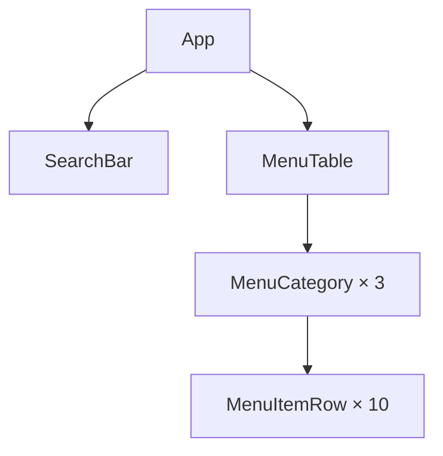

# ЛР-3. Рефакторинг за деревом компонентів

React»: сторінка «Меню кав'ярні». 

Застосунок уже працює, але весь він — один компонент `App` у `src/App.jsx`.
Ви розкладете його на компоненти в теці `src/components/`, не змінивши
сторінки. Дані меню лежать у `src/data.js`, стилі — у `src/index.css`.

## Команди

`npm install` виконуйте в корені репозиторію `react-labs`, решту — у теці
`lab-3/`:

- `npm run dev`: dev-сервер на http://localhost:5173
- `npm run lint`: ESLint
- `npm run format:check`: перевірка форматування Prettier
- `npm run build`: production-збірка в `dist/`

## Ієрархія компонентів

https://mermaid.live/.

## Стан

Для кожного рядка таблиці дайте відповідь на три питання з кроку 3 Thinking in
React (§4.7):

1. Чи залишаються ці дані незмінними з часом? Якщо так, це не стан.
2. Чи передаються вони від батьківського компонента через пропси? Якщо так, це
   не стан.
3. Чи можна обчислити їх на основі наявного стану чи пропсів? Якщо так, це
   точно не стан.

| Дані                                           | Стан? | Чому                                                                            |
| ---------------------------------------------- | ----- | ------------------------------------------------------------------------------- |
| меню: категорії й позиції (`menu`)             | ні    | залишаються незмінними з часом (імпортуються з `data.js` і передаються пропсом) |
| текст у полі пошуку                            | так   | змінюється з часом (вводить користувач) і не обчислюється з інших даних         |
| значення прапорця «Лише в наявності»           | так   | змінюється з часом (перемикає користувач) і не обчислюється з інших даних       |
| позиції, що залишаться після фільтрування      | ні    | можна обчислити на основі `menu`, тексту пошуку й значення прапорця             |
| кількість позицій у заголовку категорії, «(4)» | ні    | можна обчислити як довжину масиву позицій категорії (`items.length`)            |

Стан житиме в компоненті: `App`, бо це найближчий спільний батьківський
компонент для `SearchBar` (який відображає та змінює поля фільтрації) і
`MenuTable` (який відображає відфільтровані позиції меню).
